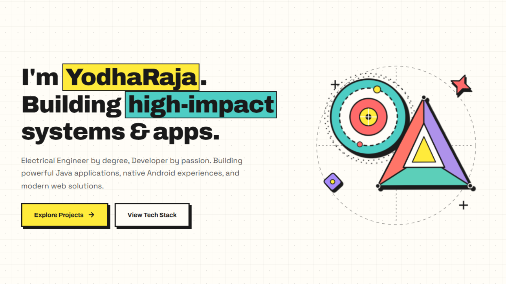

# YodhaRaja — Developer Portfolio

[](#)
[](#)
[](#)

> **Electrical Engineer by degree, Developer by passion.**  
> Building powerful Java applications, native Android experiences, and modern web solutions.

---

## Live Preview

Live Website: [yodharaja.github.io](https://yodharaja.github.io)



---

## Highlights

- **Neo-Brutalist Aesthetic:** High-contrast borders, bold geometry, and retro-modern color accents.
- **Project Showcase:** Filterable project directory loaded dynamically via `projects.json`.
- **Interactive UI:** Smooth transitions, responsive navigation, and custom geometric SVG illustrations.
- **Pure Web Performance:** Built with vanilla HTML, modern CSS, and lightweight JavaScript with zero bulky frameworks.

---

## Tech Stack

- **Frontend:** HTML5, CSS3, Modern JavaScript (ES6+)
- **Design System:** Neo-Brutalism, CSS Grid/Flexbox, SVG Canvas
- **Deployment:** GitHub Pages

---

## Getting Started

Clone the repository and open `index.html` directly in your browser:

```bash
git clone https://github.com/yodharaja/yodharaja.github.io.git
cd yodharaja.github.io
```

Or serve locally with any static server:

```bash
# Using Node / npx
npx serve .

# Using Python
python -m http.server 8000
```
